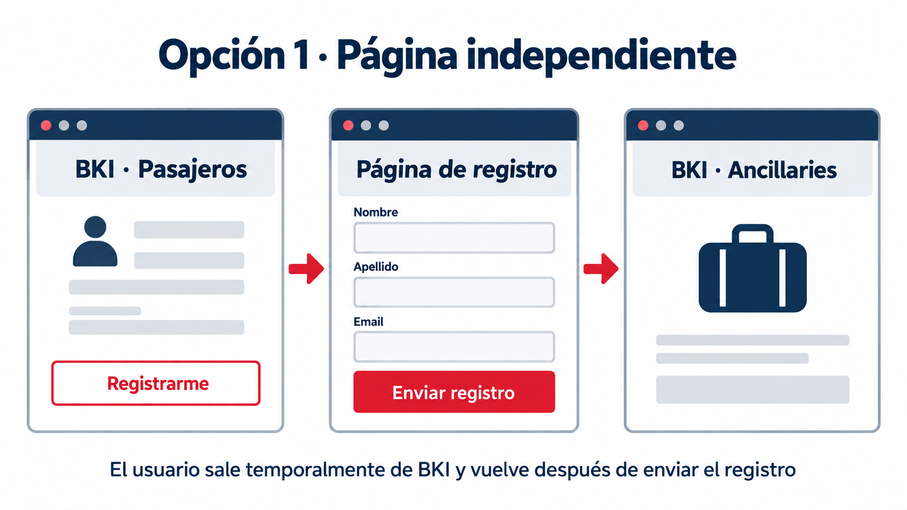
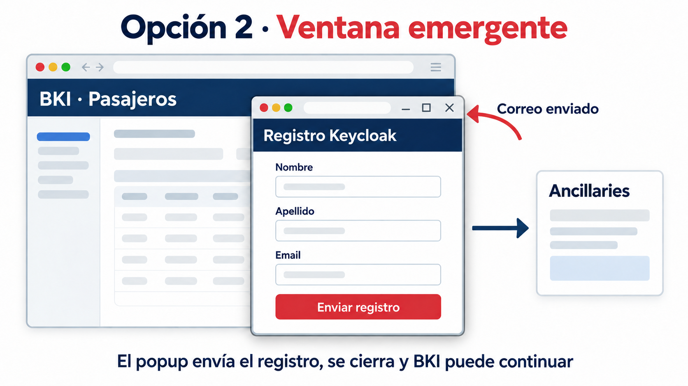
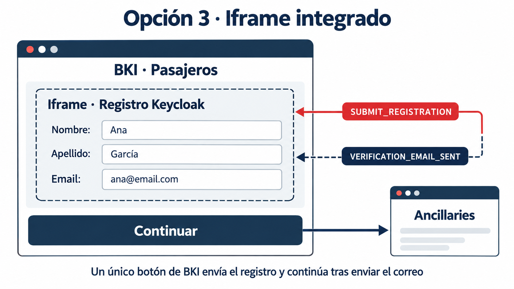

# SPIKE — Registro Iberia Club con Keycloak/LIM en BKI Pasajeros

Fecha de revisión: 2026-10-09

## Objetivo

Proponer cómo sustituir en la pantalla de pasajeros el registro actual mediante `members V2` por el nuevo registro de Keycloak/LIM, que exige verificar el correo antes de completar el alta de Iberia Club.

## Situación actual

El registro es opcional y se muestra a usuarios no identificados. Utiliza:

- Nombre y apellido del primer pasajero.
- Email de contacto.
- Contraseña.
- Aceptación de condiciones y privacidad.
- Permiso opcional de comunicaciones comerciales.

Nombre, apellido y email se precargan con datos ya introducidos en la pantalla. Al continuar, BKI crea la orden y llama a `members V2`. La compra avanza a ancillaries o pago sin esperar el resultado del registro.

Con LIM, BKI debe dejar de gestionar la contraseña y de realizar directamente el alta. Además, enviar el correo ya no significa que el usuario esté registrado: el alta termina después de verificarlo.

La gestión del botón depende de la solución elegida. Una página independiente o una ventana emergente tienen normalmente su propio botón de registro. Con un iframe se puede optar por mantener ese botón dentro del formulario o conservar un único botón de continuar de BKI que también envíe el registro.

## Soluciones posibles

### 1. Página independiente

BKI redirige al usuario a una página de Keycloak/LIM y, al terminar o cancelar, lo devuelve a pasajeros.

**Ventajas**

- Integración sencilla y estándar.
- Keycloak controla todo el proceso, incluidos errores y pantallas adicionales.
- Menos problemas de seguridad, cookies o compatibilidad.

**Inconvenientes**

- Saca al usuario del flujo de compra.
- BKI debe conservar y recuperar correctamente el estado de la reserva.
- Es la opción con mayor fricción.

**Valoración:** solución robusta, pero no recomendada como primera opción porque la redirección a pantalla completa estaba descartada.

### 2. Ventana emergente del navegador

BKI abre el registro con `window.open` en una ventana situada sobre la página, siguiendo el patrón habitual de acceso con Google u otros proveedores. No es una modal de BKI: es una ventana real del navegador, mientras la página de pasajeros permanece abierta por debajo.

Al enviar el registro, la ventana muestra que debe verificarse el correo y puede cerrarse. BKI puede mantener al usuario en pasajeros para que pulse después “Continuar” o avanzar automáticamente si la ventana comunica `VERIFICATION_EMAIL_SENT` mediante `postMessage`. No es necesario comunicar el alta final, que ocurrirá después de verificar el email.

**Autorrelleno:** sí es posible sin añadir un servicio backend. Tras abrirse, la ventana solicita los datos a `window.opener` y BKI responde mediante `postMessage`. La template de Keycloak recibe y aplica nombre, apellido y email al formulario.

Otra posibilidad es incluir los valores como parámetros de la URL y hacer que la template los lea. Es más sencilla, pero expone datos personales en la propia URL, historial y posibles logs. Las opciones del tercer argumento de `window.open` solo configuran características de la ventana, como tamaño y posición; no permiten pasar datos de aplicación.

**Ventajas**

- Mantiene el contexto de la compra.
- Keycloak conserva el control completo de su navegación.
- Evita muchas de las restricciones propias de un iframe.

**Inconvenientes**

- Puede ser bloqueada si no se abre desde una acción directa del usuario.
- En móvil puede mostrarse como otra pestaña o pantalla.
- Hay que gestionar el cierre manual y la cancelación.

**Valoración:** alternativa equilibrada si el iframe no resulta viable.

### 3. Iframe de Keycloak integrado en pasajeros

BKI sustituye el formulario actual por un iframe que carga una template de registro de Keycloak/LIM dentro de la propia pantalla.

Se deberían precargar:

- Nombre.
- Apellido.
- Email.
- Market/país e idioma, si LIM los necesita.

La contraseña se introduce exclusivamente dentro del iframe. Los checks correspondientes al alta de Iberia Club también deberían mostrarse allí, una vez LOGX-1437 confirme cuáles son y dónde se almacenan.

**Ventajas**

- El usuario realiza el registro sin abandonar visualmente la pantalla de pasajeros.
- Reutiliza los datos ya escritos por el usuario.
- Puede ocupar el mismo espacio que el módulo actual.

**Inconvenientes**

- Keycloak debe permitir que BKI lo cargue en un iframe.
- BKI no puede modificar directamente el formulario si está en otro dominio.
- Requiere un contrato para la precarga y el ajuste de altura.

La precarga puede resolverse sin un nuevo servicio:

1. La template del iframe notifica a BKI que está preparada.
2. BKI envía nombre, apellido y email a `iframe.contentWindow` mediante `postMessage`.
3. La template valida el origen del mensaje y rellena sus campos.

También se podrían utilizar parámetros de URL, con la misma consideración sobre la exposición de datos personales.

### Gestión del botón con iframe

Existen tres posibilidades:

1. **Dos botones consecutivos:** el iframe contiene “Registrarme” y BKI mantiene “Continuar”. Es la implementación más sencilla, pero obliga al usuario a completar dos acciones.
2. **Un único botón de BKI:** el usuario activa previamente “Quiero registrarme” y se muestra el iframe sin botón de envío. Al pulsar “Continuar”, BKI envía `SUBMIT_REGISTRATION` al iframe. Si el formulario tiene errores, el iframe los muestra y no se navega. Si el correo se ha enviado, responde `VERIFICATION_EMAIL_SENT` y BKI continúa a ancillaries.
3. **Botones alternativos:** el iframe muestra “Registrarme y continuar” y BKI mantiene “Continuar sin registrarme”. No exige dos clics consecutivos, pero introduce dos llamadas a la acción que pueden competir visualmente.

Para aproximarse al comportamiento actual, se recomienda la **segunda opción**. BKI solo necesita conocer que la solicitud se ha aceptado y el correo se ha enviado; no necesita esperar ni conocer el alta definitiva.

**Valoración:** permite completar el registro sin abandonar visualmente la pantalla de pasajeros, aunque mantiene la fricción añadida del nuevo botón propio.

## Comparativa

| Criterio | Página independiente | Ventana emergente | Iframe |
|---|---|---|---|
| Permanencia visual en BKI | Baja | Alta | Muy alta |
| Complejidad frontal | Baja | Media | Alta |
| Control de Keycloak | Completo | Completo | Condicionado |
| Precarga | Posible | Posible | Posible e integrada |
| Riesgo técnico | Bajo | Medio | Alto |
| Encaje con el requisito | Bajo | Alto | Muy alto |

## Conclusión sobre el autorrelleno

Tanto la **ventana emergente** como el **iframe** pueden mostrar nombre, apellido y email ya rellenados. La template de Keycloak debe leer los datos recibidos y asignarlos a los campos.

El mecanismo recomendado es prácticamente el mismo para ambas soluciones y no requiere un servicio adicional:

1. BKI abre la URL de registro en popup o iframe.
2. La template Keycloak envía un mensaje `REGISTRATION_READY`.
3. BKI comprueba el origen y la ventana que envió el mensaje.
4. BKI responde con `REGISTRATION_PREFILL` y los campos permitidos.
5. La template vuelve a validar el origen y rellena el formulario.

Los parámetros de URL son una alternativa más simple si se acepta su exposición y se evita registrar esas URLs. `login_hint` puede rellenar usuario/email en una pantalla de login, pero no resuelve por sí solo nombre y apellido del formulario de registro.

## Propuesta

La primera opción propuesta es el **iframe con una template específica de Keycloak**, porque permite reutilizar los datos del pasajero y evita abandonar visualmente la pantalla.

No se considera necesaria una PoC funcional completa. Si antes de implementar existe alguna duda técnica, bastaría con una validación mínima que demuestre que la template se carga, autorrellena los campos y puede responder a `SUBMIT_REGISTRATION` con error de validación o `VERIFICATION_EMAIL_SENT`.

Si el iframe no es viable, la solución recomendada sería la **ventana emergente**. La página independiente quedaría como fallback de menor complejidad.

## Impacto en BKI

- Sustituir la llamada a `members V2`.
- Eliminar contraseña y lógica propia de alta del formulario BKI.
- Proporcionar a LIM los datos que puedan precargarse.
- Si se mantiene un único botón, coordinar mediante `postMessage` el envío del formulario y la respuesta `VERIFICATION_EMAIL_SENT`.
- Mantener la compra independiente del resultado del alta.
- Adaptar la analítica.

El evento de registro correcto debe emitirse únicamente después de verificar el email y completar el alta, no cuando se envía el correo. Si BKI no recibe el resultado del proceso, este evento deberá publicarse desde el registro de Keycloak; BKI podría medir únicamente el clic en el botón de inicio.

## Dependencias

- **LOGX-1436:** qué lógica de `members V2` pasa a LIM y qué elimina BKI.
- **LOGX-1437 / Legal / CRM:** cuáles son los tres checks, su obligatoriedad y su destino.
- **Proyecto LIM/Keycloak:** template, precarga, configuración de iframe/popup y sesión tras el alta.
- **Producto BKI:** textos del nuevo botón, ubicación del módulo y alternativa elegida.

## Conclusión

Existen tres alternativas: página independiente, ventana emergente e iframe. Se propone probar primero el iframe con precarga de datos y utilizar la ventana emergente si las restricciones de Keycloak o de los navegadores impiden una integración fiable. En ambos casos, la compra no debería esperar a que el usuario verifique el correo.
